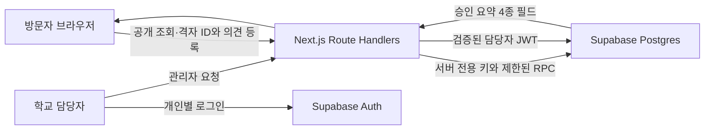

# Next.js와 Supabase 구현 설계

## 1 최소 시스템 구성

방문자의 공개 조회·등록은 Next.js Route Handler를 통해 Supabase RPC를 호출한다. 담당자 인증은 Supabase Auth를 사용하며 관리자 데이터 요청은 그 담당자의 JWT 권한으로 실행한다. Supabase에는 원문 테이블, 담당자 명단, 허용 격자, 멱등 영수증, 요청 제한 버킷, 최소 작업 이력을 저장한다. 별도 백엔드 서버·ORM·AI·Storage·Realtime는 첫 버전에서 사용하지 않는다.



정밀 클릭 좌표는 브라우저의 클릭 이벤트에서만 잠시 사용한다. 외부 지도 공급자는 타일 요청에서 화면 영역·네트워크 정보를 알 수 있으므로 ‘위치·신원 완전 익명’ 같은 표현을 사용하지 않는다. 서비스는 GPS·지도 SDK 분석 기능을 켜지 않고 클릭 이벤트 좌표를 자체 로그나 서버로 보내지 않는다.

## 2 Next.js 구조

```text
src/app/
  page.tsx                       # 개발 후 기본 지도·query alias 연결
  map/page.tsx                   # 공개 탐색
  submit/page.tsx                # 위치 선택과 입력
  submit/complete/page.tsx       # 등록 성공 결과
  player/page.tsx                # 공개 플레이어
  admin/login/page.tsx
  admin/opinions/page.tsx
  admin/opinions/[id]/page.tsx
  api/public/opinions/route.ts
  api/opinions/route.ts
  api/admin/opinions/route.ts
  api/admin/opinions/[id]/route.ts
  api/admin/opinions/[id]/action/route.ts
src/components/                  # MapCanvas, OpinionList, SubmitPanel, PlayerControls
src/lib/domain/                  # validation, grid, freshness; 순수 함수
src/lib/supabase/                # client, server, proxy, privileged client
src/lib/i18n/                    # ko/en 안내; 원문 자동번역 없음
src/lib/api/                     # 에러 DTO, allow-list 입력, 서버 권한·rate key
supabase/migrations/
tests/                          # 단위·DB 검증; 연결 E2E는 다음 단계
```

`src/proxy.ts`는 담당자 Auth 세션을 갱신한다. Next.js 16의 proxy를 사용한다. Cookie 기반 세션의 `getSession()` 반환 user를 권한 증거로 믿지 않고 `getClaims()` 또는 `getUser()`로 검증한 뒤 활성 담당자 명단을 확인한다. 관리자 POST는 Origin·세션·DB 권한을 모두 확인한다.

Supabase server-only secret client는 공개 읽기 RPC와 등록 RPC에만 사용한다. 이 키는 RLS를 우회하므로 브라우저 노출과 관리자 변경 우회에 사용하지 않는다. 관리자 조회·변경에는 SSR client + 담당자 JWT를 사용하여 RLS가 적용되도록 한다. 원문 테이블 조회를 공개 Route Handler에서 직접 구현하지 않는다.

## 3 데이터 모델

| 테이블 | 주요 필드 | 접근 |
| --- | --- | --- |
| opinions | 내부 id, 별개 public_id, cell_x/y·대표점, category, language, original_text, allow_map/player, notice_version, summary, status, include_in_player, version, created_at, deleted_at | 활성 담당자 SELECT. 제출은 서비스 RPC. 변경은 담당자 RPC |
| operator_memberships | user_id, active | 본인 상태 SELECT. 계정·명단 편집 UI 없음 |
| allowed_cells | cell_x, cell_y | 서버 전용. 초기 비어 있음 |
| service_settings | 한 행, submissions_enabled 기본 false | 서버 전용. 실제 지역·안내 확정 후 활성화 |
| submission_receipts | request_key, fingerprint, reference, opinion_id, created_at | 서버 전용. 번호만으로 조회·수정 API 없음 |
| rate_buckets | HMAC 기반 key, 기간, count | 서버 전용. 짧은 기간 후 정리 |
| admin_audit_logs | opinion_id, actor_id, action, created_at, version | 활성 담당자 SELECT; 변경 trigger만 INSERT |

격자 대표점은 cell_x/y에서 DB가 계산한다. public_id와 참고용 reference는 내부 id와 별개다. 삭제는 원문·요약을 비우고 tombstone을 유지한다. 실제 보유기간 결정 후 삭제 스케줄을 구현하되 공개 철회와 데이터 파기를 다른 단계로 취급한다.

## 4 위치 격자

개발 기본값은 포항 근처에 고정한 지역 평면 좌표 근사다. 약 200m라는 원문 요구에 맞추며 법적·측량용 정확도는 주장하지 않는다. 한국 전역 공통 Web Mercator의 200단위를 실제 200m로 오해하지 않는다.

```text
R = 6371008.8
origin_lat = 36.0; origin_lon = 129.3; reference_lat = 36.04
x_m = R * radians(lon - origin_lon) * cos(radians(reference_lat))
y_m = R * radians(lat - origin_lat)
cell_x = floor(x_m / 200)
cell_y = floor(y_m / 200)
representative x/y = ((cell_x + 0.5) * 200, (cell_y + 0.5) * 200)
대표 위경도는 위 식의 역변환
```

공유 함수의 `grid_version=pohang-v1`을 사용한다. 원점·기준 위도·크기를 변경할 때 기존 version의 셀 의미를 바꾸지 않는다. 이후 정밀 투영 좌표계가 필요하면 별도 버전을 만들고 기존 데이터의 해석을 보존한다.

서버는 cell index가 정수인지, 버전이 맞는지, `allowed_cells`에 있는지 검사한다. 위경도는 요청 필드로 받지 않고 DB에서 계산한다. 개발 패키지에는 실제 허용 지역을 넣지 않는다. 학교가 승인한 경계를 셀들의 집합으로 만든 뒤 운영에 넣는다. 경계 셀은 대표점 포함 기준으로 선택하고 셀 밖 정밀 경계까지 수집한다고 주장하지 않는다. 브라우저도 이 허용 셀 목록을 기반으로 선택 오류를 안내한다. 목록 다운로드에는 원문·의견이 없다.

원좌표는 상태·draft·localStorage·URL·network payload·Sentry context·서버 access body에 남기지 않는다. 브라우저 메모리의 최종 선택값도 대표점 또는 cell만 유지한다. 네트워크 캡처로 클릭 후 제출·오류·재시도를 확인한다.

## 5 DB 권한과 RPC

모든 public 테이블 RLS 활성화 + client role 기본 grant 철회. `anon`은 테이블을 읽거나 쓰지 못한다. `authenticated`도 활성 담당자 명단에 없으면 원문을 읽거나 바꾸지 못한다. 사용자 공개 가입과 anonymous sign-in은 끈다.

- `public.read_public_opinions(mode)`는 서비스 역할만 실행, 고정 DTO 4종만 반환한다.
- `public.submit_opinion(...)`는 서비스 역할만 실행. cell 허용, 입력 검증, 동의 종속, fingerprint, 멱등·빈도 제한·insert를 한 트랜잭션으로 처리한다.
- `public.admin_opinion_action(...)`은 authenticated만 실행하되 활성 담당자와 version을 검사한다. 2026-10-11부터 테이블 직접 UPDATE 권한을 회수하고 이 함수만 SECURITY DEFINER로 변경을 수행한다(트리거가 활성 담당자를 다시 검사). 근거는 DECISIONS.md.
- `private` trigger 함수는 공개 노출하지 않는다. 최소 이력 기록만 필요한 SECURITY DEFINER로 사용하고 `search_path=''`, 직접 EXECUTE 철회를 적용한다.
- DB 상태 제약은 published이면 지도 선택+유효 요약, 상영 포함이면 두 공개 선택, 삭제이면 원문·요약 null을 강제한다.

공개 RPC는 서비스 역할을 쓴다는 이유만으로 안전한 것이 아니다. 공개 조건, 필드 제한과 등록 검증을 SQL 자체에서 고정하고 테스트한다. 새 함수의 PUBLIC 실행 권한은 반드시 명시적으로 철회한다. 서비스 키 보유자는 고신뢰 운영 경계다.

## 6 등록 멱등성과 제한

요청 키는 UUID이고 번호 조회 권한이 아니다. Next 서버는 정규화한 허용 필드의 canonical JSON을 SHA-256 해시하여 fingerprint를 생성한다. 같은 key+fingerprint는 기존 참고 번호를 반환하고 의견을 추가하지 않는다. 같은 key+다른 fingerprint는 409. 키 단위 DB advisory lock과 영수증 unique 제약으로 여러 서버·동시 요청에서도 직렬화한다.

빈도 제한은 서버에서 배포 플랫폼이 제공하는 신뢰된 client IP를 일일 HMAC으로 변환해 적용한다. 임의 `X-Forwarded-For` 첫 값을 믿지 않는다. trust 설정이 없으면 운영 등록을 열지 않는다. 원 IP는 저장하지 않는다. 10분·일일 버킷 갱신은 DB 트랜잭션으로 처리한다. 재시도된 같은 성공 요청은 제한 건수에 다시 포함하지 않는다. HMAC은 완전한 익명화 주장이 아니라 원 IP를 직접 저장하지 않기 위한 제한 수단이다. 만료 버킷의 48시간 정리를 운영 작업으로 설정한다.

## 7 철회 반영과 플레이어 상태

공개 데이터 fetch는 cache:no-store; 응답 Cache-Control:no-store; 동적 Route Handler. Next 데이터 캐시·CDN·Service Worker를 사용하지 않는다. 지도·플레이어는 공통 신선도 컨트롤러를 사용한다.

상태: loading → fresh / empty → stale 또는 offline/hidden. 공개 성공 확인 시각은 `performance.now()`로 저장한다. 30초 간격 조회와 별도 60초 만료 타이머를 둔다. 요청 timeout 10초. 조회 실패 한 번으로 빈 배열이라고 거짓 표시하지 않는다. 단, 확인이 60초 넘게 실패하면 이전 사례를 지운다.

visibilitychange(hidden)·offline: 즉시 카드/핀/목록을 제거하고 재생 정지, 기존 요청 무효화. visible·online: 무조건 새 요청부터, 성공 후 정지 상태로 표시. 현재 public_id가 사라지면 현재 index를 유효 범위로 재계산한다. 새 목록이 와도 선택은 index보다 public_id로 유지한다. 갱신 성공은 재생 시작 동작이 아니다.

## 8 관측과 비용

로그는 API 경로·상태·소요시간·비민감 오류 코드만 기본 수집한다. 원문·요약·등록 payload·정밀 좌표·receipt·Authorization은 로그에서 제외한다. 지도 클릭 분석·세션 리플레이는 사용하지 않는다. 단순 서비스 모니터링을 자동 통계 제품 기능으로 확대하지 않는다.

실제 동시접속과 지도 타일 이용량이 미정이므로 월 비용을 확정하지 않는다. 출시 전 DB 용량·공개 polling 요청량·지도 공급자 비용·Next 서버 비용을 예상 사용량으로 계산한다. 이 설계는 단일 학교·단일 공개 의견지도 기준이며 멀티테넌트 구조를 선제 추가하지 않는다.

## 9 기술 근거

2026년 10월 6일 확인. 구현 시 설치 버전의 문서도 재확인한다.

- [Next.js 설치와 App Router](https://nextjs.org/docs/app/getting-started/installation)
- [Supabase Next.js SSR client와 proxy](https://supabase.com/docs/guides/auth/server-side/creating-a-client?queryGroups=framework&framework=nextjs)
- [Supabase RLS와 grants](https://supabase.com/docs/guides/database/postgres/row-level-security)
- [Supabase 사용자 스키마](https://supabase.com/docs/guides/api/using-custom-schemas)
- [Supabase API key](https://supabase.com/docs/guides/api/api-keys)
- [Leaflet API](https://leafletjs.com/reference.html)
- [OSM 타일 정책](https://operations.osmfoundation.org/policies/tiles/): 지도 공급자 확정 시 라이선스·사용량·출처·캐시 정책 확인. 공개 OSM 서버를 운영 SLA가 있는 기본 공급자로 가정하지 않는다.
- [Supabase changelog](https://supabase.com/changelog): 기존 ltree/pgcrypto 대상 변경은 이번 신규 격자 스키마에서 사용하지 않음. @supabase/server deprecated adapters 대신 @supabase/ssr 사용.
