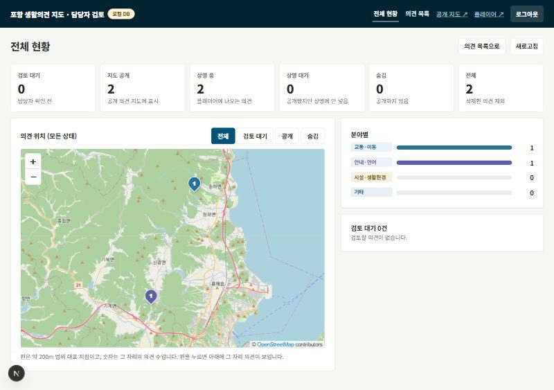
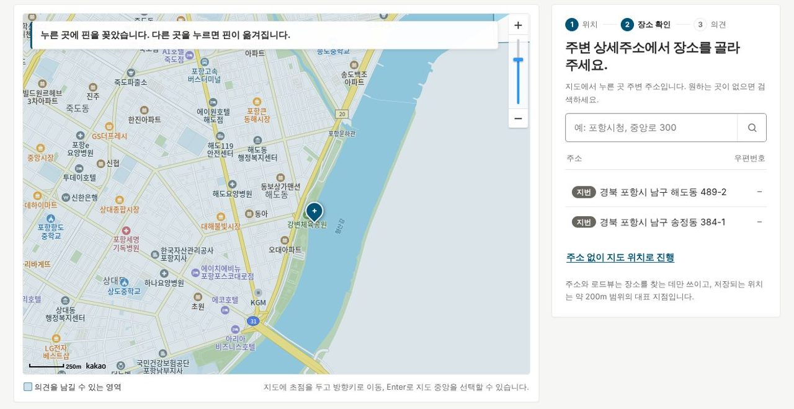
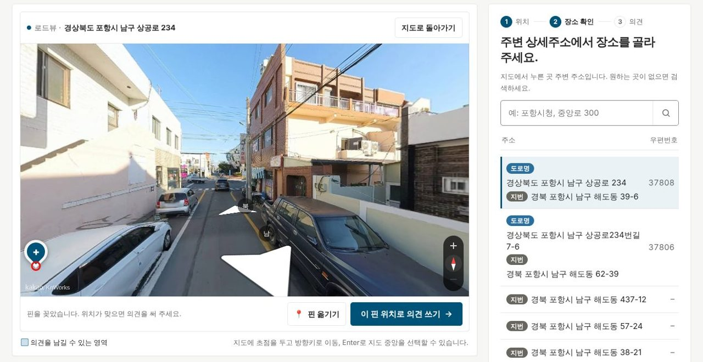
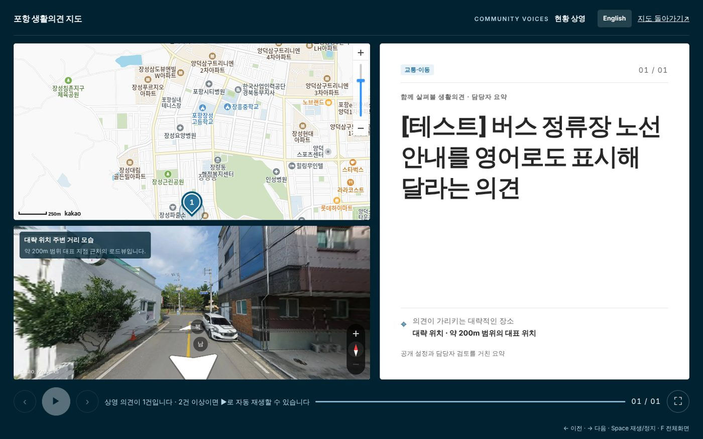
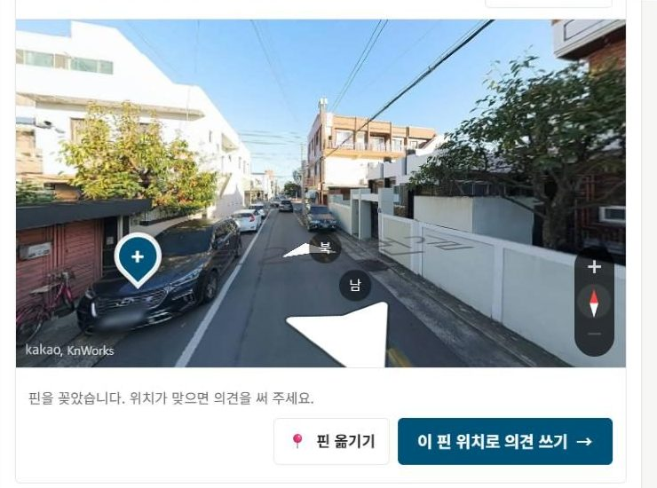
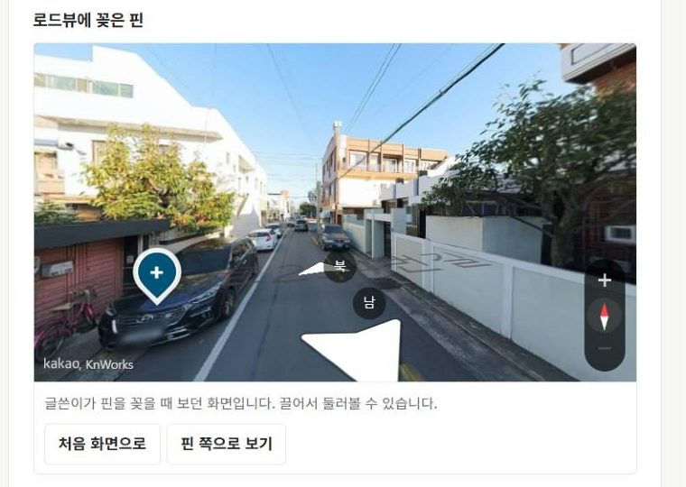
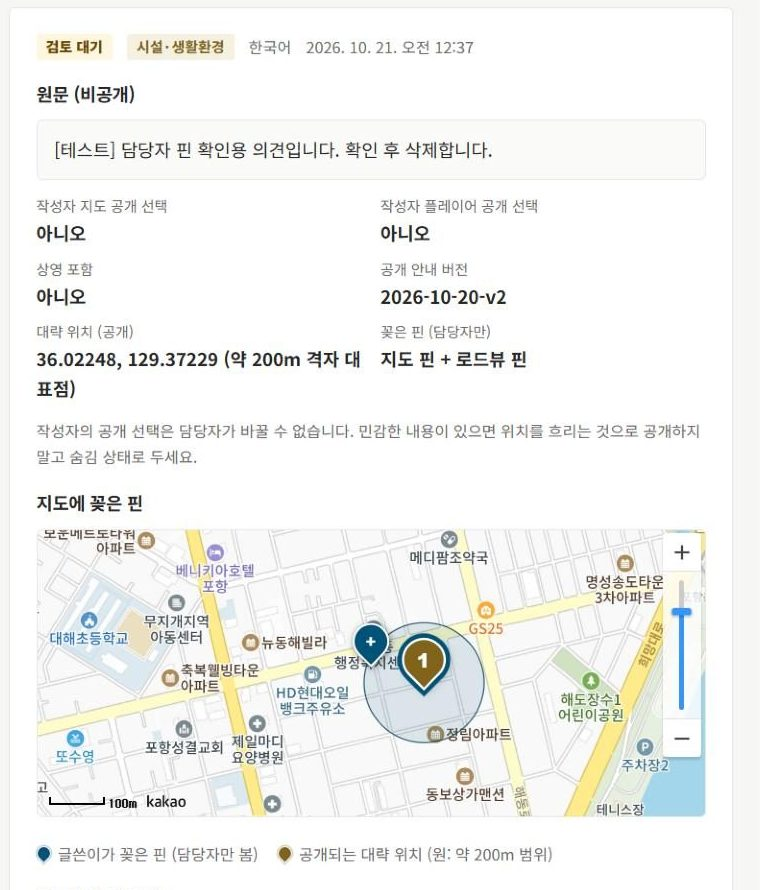

# 포항 생활의견 지도 · 피드백 반영 정리 (2026-10-21)

10월 19~21일에 받은 팀 피드백과 피그마 피드백(박민찬)을 어떻게 바꿨는지, 지금 상태와 남은 일까지 한 번에 정리했습니다. 담당자 계정 정보는 넣지 않았습니다.
같은 내용을 한 파일로 보려면 [feedback-summary.html](feedback-summary.html)을 내려받아 브라우저로 여세요(스크린샷 포함).

## 한눈에 보기

| # | 받은 피드백 | 반영 내용 | 상태 |
| --- | --- | --- | --- |
| 1 | 의견을 남긴 뒤 플레이어에서 재생이 안 됨 (팀) | 상영 조건 안내, 테스트 모드(검토 없이 바로 공개, 시간이 지나면 자동으로 꺼짐), 상세 화면의 ‘지도·플레이어에 공개’ 한 번에 | 배포 완료 |
| 2 | DB를 만들지 않아도 로컬 DB로 API와 함께 돌릴 수 있게 (팀) | 로컬 DB 모드(PC 안의 내장 DB, Supabase와 같은 SQL), Windows용 `로컬DB로실행.bat` | 완료 |
| 3 | route를 분리해 민원을 관리하는 관리자 페이지 (박민찬) | `/admin`을 ‘전체 현황’ 화면으로 새로 만들고, 목록은 `/admin/opinions`로 분리 | 배포 완료 · 댓글 뒷부분 확인 필요 |
| 4 | PIN 주변 영역 대신 PIN만 찍히게 (박민찬) | 약 200m 원 표시를 없애고 누른 자리에 핀만. 같은 칸 안을 다시 눌러도 핀이 옮겨짐 | 배포 완료 |
| 5 | 지도에 찍힌 PIN과 거리맵(로드뷰)에 찍힌 곳을 같이 보여 주기 (박민찬) | 플레이어: 지도 아래 ‘대략 위치 주변 거리 모습’. 담당자 상세: 글쓴이가 꽂은 **지도 핀 + 로드뷰 핀**(같은 장면을 다시 열어 표시) | 배포 완료 · SQL 적용 |
| 6 | 로드뷰 테두리에는 PIN이 안 꽂힘 (박민찬) | 가장자리에서도 누른 자리에 정확히 꽂히게 방향 계산 수정 | 배포 완료 |
| 7 | DESIGN.md로 디자인 깔끔하게 적용 (팀) | 이번 범위에서 빼 둠 | 보류 |

## 서비스 주소

| 용도 | 주소 |
| --- | --- |
| 공개 의견 지도 | https://newdawn-handong.vercel.app/map |
| 의견 남기기 | https://newdawn-handong.vercel.app/submit — 지도 → 주소 → 로드뷰 핀 → 의견 작성 |
| 현황 상영(플레이어) | https://newdawn-handong.vercel.app/player — 간담회·공개 상영 화면 |
| 담당자 화면 | https://newdawn-handong.vercel.app/admin — 로그인 후 ‘전체 현황’, ‘의견 목록’(`/admin/opinions`) |

담당자 계정은 공개 가입이 없고, 담당자마다 따로 만들어 쓰는 것을 원칙으로 합니다.

## 1. 플레이어에서 재생이 안 되던 문제

**원인**: 플레이어에는 ① 글쓴이가 ‘지도에 요약 공개’와 ‘플레이어에 요약 공개’를 모두 고르고 ② 담당자가 요약을 써서 공개하고 ③ ‘상영에 포함’을 누른 의견만 나옵니다. 자동 재생은 2건 이상일 때 됩니다. 팀 테스트에서는 담당자 검토를 거치지 않아 나오지 않았습니다. 고장이 아니라 규칙 때문이었습니다.

- **테스트 모드**: 담당자 ‘의견 목록’ 위의 스위치로 3·12·24·72시간 동안 켭니다. 켜진 동안 지도 공개를 고른 새 의견은 검토 없이 바로 공개되고(원문 앞 250자를 요약으로 씀), 플레이어 공개도 고르면 바로 상영됩니다. 정한 시간이 지나면 저절로 꺼지고, 누가 언제 켰는지 기록이 남습니다. **지금은 꺼져 있고, 정식 운영 전에는 반드시 꺼 두어야 합니다.**
- **한 번에 공개**: 상세 화면의 ‘지도·플레이어에 공개’ 버튼 하나로 요약 저장 → 공개 → 상영 포함이 차례로 처리됩니다(각각 이력에 남음). ‘지도에만 공개’ 버튼도 따로 있습니다.
- **플레이어 안내**: 빈 화면에 위의 세 조건을 적어 두고, 멈춘 상태에서는 ‘▶ 또는 Space로 재생’을 보여 줍니다.

## 2. 로컬 DB 모드 (Supabase 없이 PC에서 실행)

- DB를 따로 만들지 않아도 의견 등록·공개 지도·플레이어·담당자 검토까지 모든 화면과 API를 PC 한 대에서 쓸 수 있습니다. Docker도 필요 없습니다.
- Windows: 프로젝트 폴더의 `로컬DB로실행.bat`을 더블클릭한 뒤 `http://localhost:3000`을 엽니다. 처음 실행은 설치 때문에 몇 분 걸립니다.
- 데이터는 `.local-db/` 폴더에, 로컬 담당자 계정은 `.local-db/admin-account.txt`에 있습니다(Git에는 올라가지 않음).
- Supabase와 **같은 SQL**을 그대로 적용하므로 권한·공개 조건이 실제 사이트와 같습니다. 새 SQL은 다음 실행 때 자동으로 적용되니, 코드를 업데이트한 뒤에는 창을 닫고 다시 실행합니다.
- 한계: 카카오 지도 키가 없으면 OpenStreetMap 지도로 나오고 로드뷰는 나오지 않습니다. 로드뷰 관련 기능은 실제 사이트에서 확인합니다.

*로컬 DB 모드에서 연 담당자 ‘전체 현황’ 화면(팀원 PC). 상태별 건수, 분야별 막대, 의견 위치 지도, 검토 대기 목록이 나옵니다.*

## 3. 피그마 피드백 반영 (박민찬)

### 3-1. 관리자 페이지 분리: ‘전체 현황’

- `/admin`: 상태별 건수(검토 대기·지도 공개·상영 중·상영 대기·숨김·전체), 분야별 막대, 모든 상태의 의견 위치 지도(핀을 누르면 그 자리 의견 목록), 최근 검토 대기. 로그인하면 바로 이 화면으로 옵니다.
- `/admin/opinions`: 기존 의견 목록과 상세(검토·공개·숨김·삭제)는 그대로입니다.
- 받은 댓글이 “* 민원 전체적으로 확인 * 민…”에서 잘려 있어, 뒷부분에 다른 요청이 있었다면 알려 주세요.

### 3-2. 영역 대신 핀만

의견 남기기 지도에서 약 200m 원을 없애고 누른 자리에 핀 하나만 꽂습니다. 원 안(같은 칸)을 다시 눌러도 핀이 그 자리로 옮겨집니다. 공개되는 위치는 예전처럼 약 200m 칸의 대표 지점입니다.

*실제 사이트: 누른 곳에 핀만 꽂히고, 오른쪽에 주변 상세주소가 나옵니다.*

### 3-3. 로드뷰 테두리에도 핀이 꽂히게

로드뷰 가장자리를 누르면 방향 계산이 화면 밖으로 나가 핀이 안 꽂히던 문제를 고쳤습니다. 실제 카카오 로드뷰에서 가운데·네 모서리·위쪽 끝·왼쪽 끝 7곳을 눌러 모두 누른 자리에 꽂히는 것을 확인했습니다.

*실제 사이트: 로드뷰 왼쪽 아래 가장자리를 눌렀을 때. 빨간 원이 누른 곳이고, 핀 끝이 정확히 그 자리에 있습니다.*

### 3-4. 지도 핀과 거리맵(로드뷰) 핀을 같이 보기

**플레이어(공개 화면)**: 지도 아래에 ‘대략 위치 주변 거리 모습’(카카오 로드뷰)을 함께 보여 줍니다. 공개 화면이므로 글쓴이가 꽂은 정확한 자리가 아니라 약 200m 칸 대표 지점 근처 모습입니다.

*실제 사이트 플레이어: 왼쪽 위 지도 핀, 왼쪽 아래 거리 모습, 오른쪽 담당자 요약.*

**담당자 상세(담당자만)**: 글쓴이가 지도에 꽂은 핀과, 로드뷰에 꽂은 핀을 그때 보던 장면 그대로 보여 줍니다. 캡처 사진을 저장하지 않고, 저장한 지점·방향으로 카카오 로드뷰를 다시 열어 핀을 같은 자리에 꽂는 방식입니다. 화면이 좁아 핀이 밖으로 나가면 핀 쪽으로 저절로 돌리고, ‘처음 화면으로’·‘핀 쪽으로 보기’ 버튼도 있습니다.

| ① 글쓴이 화면: 로드뷰의 검은 차 위에 핀을 꽂음 | ② 담당자 상세: 같은 장면, 같은 차 위에 핀 |
| --- | --- |
|  |  |

*③ 담당자 상세 위쪽: ‘꽂은 핀(담당자만): 지도 핀 + 로드뷰 핀’. 지도에는 꽂은 핀(파란 +)과 공개되는 약 200m 원이 보입니다. 10월 21일 실제 사이트에 시험 의견을 등록해 확인한 뒤 삭제했습니다.*

## 4. 개인정보 관련 바뀐 점

> **원래 원칙**: 위치는 약 200m 칸 번호만 저장하고, 누른 정확한 좌표는 서버로 보내지 않는다. 3-4의 담당자 상세 기능을 위해 이 원칙을 **담당자 검토 용도에 한해** 바꿨습니다.

| 항목 | 내용 |
| --- | --- |
| 무엇을 저장하나 | 지도에 꽂은 좌표(고른 약 200m 칸 안이어야 함), 로드뷰에 핀을 꽂았으면 그 방향과 그때 보던 로드뷰 시점. 주소 글자와 사진은 저장하지 않습니다. |
| 누가 보나 | 담당자 상세 화면에서만 봅니다(활성 담당자 명단으로 DB에서 확인). 공개 지도·플레이어·공개 API·담당자 목록·전체 현황에는 나오지 않습니다. 로그인하지 않은 사용자가 DB를 직접 읽으려 해도 막히는 것을 실제 DB에서 확인했습니다. |
| 언제 지우나 | 의견을 삭제하면 함께 지워집니다. 지금은 따로 정한 보유 기간이 없습니다. |
| 글쓴이 안내 | 의견 쓰는 화면의 안내를 “공개되는 위치는 약 200m 범위의 대표 지점이고, 꽂은 핀의 정확한 위치는 담당자 검토에만 쓰입니다”로 바꾸고, 공개 안내 버전을 `2026-10-20-v2`로 올렸습니다. |
| 예전 의견 | 10월 20일 SQL을 적용하기 전에 등록된 의견은 핀 정보가 없어 상세에 ‘저장 안 됨’으로 나옵니다. |

**학교 확인 필요**: 정확한 핀의 보유 기간과 담당자 접근 범위를 학교 개인정보 안내문에 넣어야 합니다.

## 5. 확인한 내용

- 자동 테스트 모두 통과: 단위 19 · DB 9 · 로컬 DB 6 · 브라우저(로컬 DB) 4 · 카카오 모드(검수용 가짜 SDK) 6, 린트·타입 검사·빌드.
- 실제 카카오 로드뷰: 글쓴이가 로드뷰 화면의 (가로 72%, 세로 70%)에 꽂은 핀이 담당자 화면에서도 (72.0%, 70.0%)에 나왔습니다. 휴대폰 폭(390px)에서는 핀 쪽으로 저절로 돌아가 핀이 보입니다.
- 실제 사이트: 시험 의견 등록 → 담당자 상세에서 지도 핀·로드뷰 핀 확인 → 삭제(핀도 함께 삭제)까지 확인했습니다.
- 10-19 변경(로컬 DB·테스트 모드)과 10-20 변경(정확한 핀)은 각각 별도 검토 에이전트가 코드를 읽고 재현 테스트를 했고, 지적된 문제를 고친 뒤 배포했습니다. 예를 들어 옛 SQL을 다시 실행해도 등록이 멈추지 않게, 핀을 재는 중 장소를 바꾸면 옛 핀이 붙지 않게 고쳤습니다.

## 6. 지금 상태와 남은 일

| 항목 | 상태 |
| --- | --- |
| 배포 | master에 올리면 Vercel이 자동 배포합니다. 위 변경은 모두 반영됐습니다. |
| Supabase SQL | 10-19(테스트 모드), 10-20(정확한 핀) 모두 적용했습니다. `supabase/manual/`의 10-19 파일은 이제 다시 실행하지 않습니다. |
| 테스트 모드 | 꺼짐 |
| 담당자 비밀번호 | 변경 완료(이 문서에 넣지 않음) |

### 남은 일 · 정해야 할 것

- 박민찬 님 댓글 1번 뒷부분 내용 확인 → 필요하면 전체 현황 화면에 추가 반영
- DESIGN.md를 이용한 디자인 적용(보류 중) 진행 여부
- 학교 확정: 정확한 핀 보유 기간·개인정보 안내, 실제 수집 지역, 담당자 계정(개인별 발급)
- 정식 운영 전: 테스트 모드 꺼짐 확인, ‘[테스트]’로 시작하는 시험 의견 정리
- 선택: 담당자 화면에 ‘비밀번호 바꾸기’ 메뉴 추가. 로컬 PC에서도 로드뷰를 보려면 카카오 개발자 콘솔에 `http://localhost:3000`을 등록하고 키를 설정
